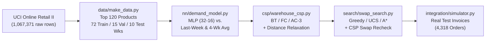
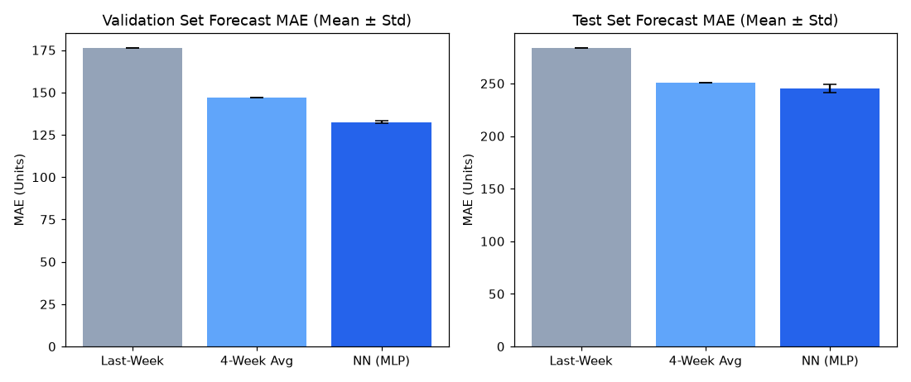
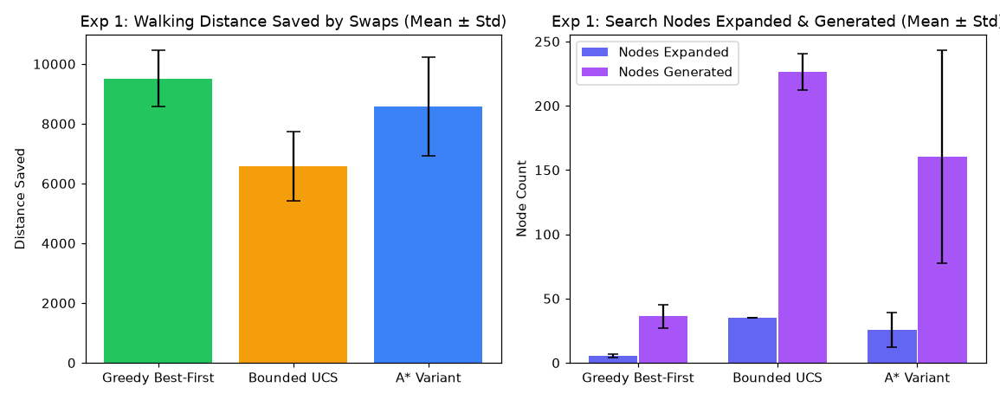
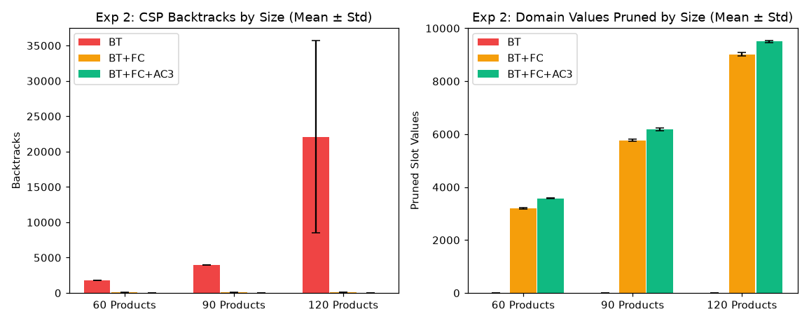
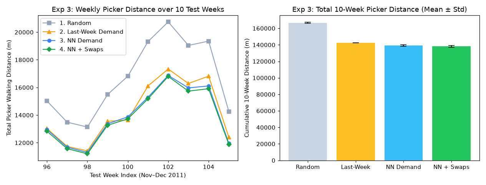

# Technical Report: P8 – Warehouse Re-Slotting from Predicted Demand
**Integrating Neural Network Demand Forecasting, Constraint Satisfaction (CSP), and Heuristic Swap Search**

---

## 1. Problem Description & Motivation

Order picking—the process in which human warehouse workers ("pickers") walk from a central packing depot to storage shelves to collect items for customer orders—accounts for 50% to 60% of operating labor costs in retail distribution centers. Because product popularity fluctuates over time and across seasons, a static shelf layout quickly becomes inefficient: high-demand products placed far from the depot force pickers to walk unnecessary kilometers every day.

At the same time, warehouse planners cannot simply sort shelves by predicted sales volume. Real warehouses enforce strict operational and safety rules:
1. **Slot Capacity**: Each shelf slot holds at most one product SKU (`AllDifferent`).
2. **Ergonomic Heavy-Item Placement**: Heavy products must be stored on ground-level shelves (`shelf_level == 0`) to prevent worker injury.
3. **Co-Purchase Affinity**: Product pairs that customers frequently buy together in the same order should be placed within a maximum walking distance ($d_{\max}$) of one another.
4. **Category Incompatibility**: Hazardous or scented categories (such as `Cleaning_Chemical`) must not share an aisle with sensitive categories (such as `Food_Kitchen`).

**Project Goal**: Build an integrated decision-support pipeline that:
1. **Forecasts** next-week unit demand per product using a Neural Network (`nn/demand_model.py`),
2. **Constructs** a valid initial shelf assignment using a switchable Constraint Satisfaction Problem solver (`csp/warehouse_csp.py`) with automatic distance relaxation when constraints are over-tight,
3. **Refines** the layout using up to 6 pairwise swaps among the 30 highest-demand products and near-depot slots (`search/swap_search.py`), rechecking every swap with the CSP verifier, and
4. **Evaluates** the resulting layouts on real held-out customer invoices (`integration/simulator.py`).

---

## 2. Design Choices & System Architecture

To prioritize interpretability, reproducibility, and ease of explanation, we made four deliberate engineering choices:
- **Log-Space Demand Target**: Retail order quantities exhibit heavy right-skewness (e.g., occasional 2,000-unit wholesale orders). Training the Neural Network on $\ln(1 + \text{units})$ stabilizes gradients and prevents single wholesale spikes from dominating training.
- **Demand-Guided CSP Variable Ordering**: Standard CSP solvers only test feasibility rather than optimizing an objective. By ordering variables (products) by descending predicted demand—placing each high-demand product's co-bought partners immediately after it—and ordering domain values (slots) by warehouse zone outward from the depot, the CSP naturally constructs a high-quality initial layout.
- **Zone-to-Slot Division of Labor Between CSP and Search**: To ensure heavy items never run out of ground-level shelves, the CSP fills upper-level shelves (`shelf_level = 1`) first within each warehouse zone and reserves ground-level slots (`S000, S002, ...`) for heavy items. Consequently, a moderate-demand heavy item may occupy the closest low shelf `S000`, while a higher-demand light item sits several bays back. **Swap Search** then performs fine-grained pairwise swaps (rechecked by the CSP) to move top sellers into the exact closest bays.
- **Strict Prevention of Data Leakage**: Both the `StandardScaler` parameters and the **top 30 co-purchase pairs** are computed strictly from the **72 training weeks**, never touching the 15 validation or 10 test weeks.

---

## 3. Dataset & Preprocessing (`data/make_data.py`)

We use the public **UCI Online Retail II** dataset (`data/online_retail_II.xlsx`), covering transactions of a UK-based online retailer from **1 December 2009 to 9 December 2011**:
- **Local Format Adaptation**: The raw file in `data/` is a two-sheet Excel workbook (`Year 2009-2010` with 525,461 rows and `Year 2010-2011` with 541,910 rows, totaling **1,067,371 raw rows**). `data/make_data.py` merges both sheets into a local CSV cache (`data/online_retail_II_combined.csv`) so subsequent runs finish in ~2 seconds.
- **Cleaning Rules**:
  1. Remove cancelled invoices (`Invoice` starting with `'C'`).
  2. Drop rows with missing `StockCode` or `InvoiceDate`, or non-positive `Quantity <= 0` or `Price <= 0`.
  3. Remove non-merchandise accounting/postage codes (`POST`, `D`, `M`, `BANK CHARGES`, `PADS`, `DOT`, `CRUK`, `ADJUST`, `TEST001`, `TEST002`), leaving **1,037,361** valid transactions.
- **Top 120 Subset & Weekly Aggregation**: We select the **top 120 products** by total unit volume (**173,404** transactions) and aggregate sales across all **105 Monday-start calendar weeks** (`120 × 105 = 12,600` product-week rows). Product-weeks with zero sales are filled with `units = 0.0` and imputed with the product's historical median price.
- **Chronological Split**:
  - **Weeks 0–7 (8 weeks)**: Initial lag history window (`history_only`).
  - **Weeks 8–79 (72 weeks)**: **Training set** (`8,640` product-week examples; also used to extract the top 30 co-purchase pairs).
  - **Weeks 80–94 (15 weeks)**: **Validation set** (`1,800` product-week examples).
  - **Weeks 95–104 (10 weeks)**: **Held-out Test set** (`1,200` product-week examples and **4,318** real customer invoices).
- **Simulated Warehouse Grid (`seed=42`)**:
  - `120` shelf slots arranged in `6 aisles (0–5) × 10 bays (0–9) × 2 shelf levels (0=low, 1=upper)`.
  - Corner depot `(0,0)` walking distance: $\text{aisle} \times 2 + \text{bay} + 1 + \text{shelf\_level}$ meters.
  - Optional second warehouse shape (`central_depot` at aisle 2.5, bay 0): $\lfloor |\text{aisle} - 2.5| \times 2 + 1.5 \times \text{bay} + 1 + \text{shelf\_level} \rfloor$ meters.

---

## 4. Neural Network vs. Baselines (`nn/demand_model.py`)

### 4.1 Features, Architecture, and Baselines
For each product and week $t \ge 8$, the model receives **11 input features**:
- Past 8 weeks of log-transformed sales: $\ln(1 + \text{units}_{t-1}), \dots, \ln(1 + \text{units}_{t-8})$
- Calendar seasonality: `week_of_year` $\in \{1, \dots, 52\}$
- Price signal: $\text{mean\_price}_{t-1}$
- Order frequency signal: $\ln(1 + \text{invoice\_count}_{t-1})$

We compare a 2-layer **Multi-Layer Perceptron (`MLPRegressor`)** with `(32, 16)` ReLU hidden units, Adam optimizer (`lr=0.005`, L2 penalty `alpha=0.05`, `early_stopping=True`) against two retail baselines:
1. **Last-Week Baseline**: $\hat{y}_t = y_{t-1}$
2. **4-Week Moving Average Baseline**: $\hat{y}_t = \frac{1}{4}\sum_{k=1}^{4} y_{t-k}$

### 4.2 Forecast Results (5 Seeds: `42, 43, 44, 45, 46`)

| Model | Validation MAE (Mean ± Std) | Validation RMSE (Mean ± Std) | Test MAE (Mean ± Std) | Test RMSE (Mean ± Std) |
| :--- | :---: | :---: | :---: | :---: |
| **Last-Week Baseline** | 176.24 ± 0.00 | 331.58 ± 0.00 | 283.73 ± 0.00 | 2382.21 ± 0.00 |
| **4-Week Avg Baseline** | 146.89 ± 0.00 | 268.76 ± 0.00 | 250.96 ± 0.00 | **2368.30 ± 0.00** |
| **Neural Network (MLP)** | **132.49 ± 0.74** | **262.52 ± 1.10** | **245.28 ± 3.75** | 2373.15 ± 1.38 |

**Analysis**: The MLP achieves the lowest **MAE** on both the validation set (`132.49` vs. `146.89` for 4-Week Avg) and the held-out test set (`245.28` vs. `250.96` for 4-Week Avg and `283.73` for Last-Week). On **Test RMSE**, however, the 4-Week Moving Average (`2368.30`) slightly beats the MLP (`2373.15`) by 4.85 units because the final 10 test weeks coincide with the pre-Christmas wholesale rush (Oct–Dec 2011), where extreme single-order spikes heavily penalize squared error when exponentiating log-predictions.

---

## 5. Constraint Satisfaction Problem Solver (`csp/warehouse_csp.py`)

### 5.1 Variables, Domains, and Constraints
- **Variables**: Products $P_1, \dots, P_N$ ($N \in \{60, 90, 120\}$).
- **Domains**: Warehouse shelf slots $S_{000}, \dots, S_{119}$.
- **Hard Constraints**:
  1. $\text{slot}(P_i) \ne \text{slot}(P_j)$ for all $i \ne j$ (`AllDifferent`).
  2. If $\text{is\_heavy}(P_i) = 1$, then $\text{is\_low\_shelf}(\text{slot}(P_i)) = 1$.
  3. For each of the **top 30 training co-purchase pairs** $(P_i, P_j)$, grid distance $|\text{aisle}_i - \text{aisle}_j|\times 2 + |\text{bay}_i - \text{bay}_j| \le d_{\max}$.
  4. For incompatible category pairs (`Cleaning_Chemical` vs. `Food_Kitchen`), $\text{aisle}(\text{slot}(P_i)) \ne \text{aisle}(\text{slot}(P_j))$.

### 5.2 Switchable Filtering Modes & Distance Rule Relaxation
We implement three switchable solver configurations:
- **Pure Backtracking (`BT`)**: Starts with all 120 slots per product and tests constraints only upon assignment.
- **Backtracking + Forward Checking (`BT+FC`)**: After assigning $P_i = s$, immediately prunes $s$, distance-violating slots for co-bought partners, and same-aisle slots for incompatible partners from unassigned domains.
- **Backtracking + Forward Checking + AC-3 (`BT+FC+AC3`)**: Enforces unary heavy-shelf node consistency upfront and runs the `AC-3` arc-revision queue over all binary constraints before and during search.
- **Step-by-Step Distance Relaxation (`solve_csp_with_relaxation`)**: When a strict initial co-purchase distance (e.g., $d_{\max} = 2\text{ m}$) admits no solution, the solver increments $d_{\max}$ by `2` meters step-by-step ($2 \to 4 \to 6\text{ m}$) and reports `loosest_distance_used = 6`.

---

## 6. Heuristic Swap Search (`search/swap_search.py`)

### 6.1 Formulation & Known-Answer Verification
- **State**: A complete valid layout assignment $\{P_i \mapsto S_k\}$.
- **Action**: Swap the assigned slots of two products chosen from the **30 highest-demand products** and the **30 slots nearest the depot**, provided `verify_full_layout_csp(new_layout)` returns `True`.
- **Step Cost**: $1$ per swap ($g(n) = \text{swaps count}$).
- **Heuristic Objective $h(n)$**: Demand-weighted round-trip walking distance plus co-purchase pair distance:
  $$D(\text{layout}) = \sum_{p} 2 \cdot \widehat{\text{demand}}(p) \cdot \text{dist}_{\text{depot}}(\text{slot}(p)) + \sum_{(p_a, p_b) \in \text{Top30}} 15 \cdot \text{dist}(\text{slot}(p_a), \text{slot}(p_b))$$
- **Goal Test**: $D(\text{layout}) \le 0.978 \times D(\text{initial})$ or $g(n) = 6$ swaps.
- **Small Known-Answer Test**: On our 4-product, 4-slot toy warehouse (`P1` demand `100` at far slot `S3` dist `10m`; `P4` demand `5` at front slot `S0` dist `1m`), Greedy Search swaps `P1` and `P4` in `1` swap, reducing cost from `2370.0` to the exact analytical optimum `660.0`.

---

## 7. Experimental Evaluation (5 Seeds: `42, 43, 44, 45, 46`)

### 7.1 Experiment 1: Greedy Best-First vs. Bounded UCS vs. A* Variant

| Algorithm | Initial Cost | Final Cost (Mean ± Std) | Distance Saved (Mean ± Std) | Swaps (Mean ± Std) | Nodes Expanded (Mean ± Std) | Nodes Generated (Mean ± Std) | Runtime (ms) |
| :--- | :---: | :---: | :---: | :---: | :---: | :---: | :---: |
| **Greedy Best-First (Main)** | 433207.8 | **423693.3 ± 28213.0** | **9514.5 ± 943.1** | 4.4 ± 1.1 | **5.4 ± 1.1** | **36.2 ± 9.1** | **183.82 ± 37.74** |
| **Bounded UCS (Baseline)** | 433207.8 | 426628.3 ± 29052.1 | 6579.5 ± 1160.4 | 2.0 ± 0.0 | 35.0 ± 0.0 | 226.4 ± 14.0 | 1501.15 ± 96.15 |
| **A* Variant** | 433207.8 | 424633.5 ± 28767.3 | 8574.3 ± 1662.3 | **3.4 ± 0.5** | 25.6 ± 13.3 | 160.4 ± 82.8 | 1031.29 ± 560.48 |

**Findings**:
- **Greedy Best-First Search** achieves the highest walking distance reduction (`9,514.5 ± 943.1`) while expanding only `5.4 ± 1.1` nodes in `183.82 ms`.
- **Bounded UCS** ignores the heuristic $h(n)$ and expands states breadth-first by swap count $g(n)$, exhausting its `35`-node budget at depth `2` (`6,579.5` saved).
- **A\* Variant** balances swap count $g(n)$ and scaled remaining distance $h(n)$, achieving `8,574.3` distance saved in **fewer swaps (`3.4 ± 0.5`)** than Greedy (`4.4 ± 1.1`).

---

### 7.2 Experiment 2: CSP Scaling Across 60, 90, and 120 Products (`BT` vs. `BT+FC` vs. `BT+FC+AC3`)

| Products | CSP Mode | Assignments (Mean ± Std) | Backtracks (Mean ± Std) | Values Pruned (Mean ± Std) | Runtime (ms) |
| :---: | :--- | :---: | :---: | :---: | :---: |
| **60** | **BT** | 1863.4 ± 9.9 | 1803.4 ± 9.9 | 0.0 ± 0.0 | 0.65 ± 0.05 |
| **60** | **BT+FC** | 128.0 ± 16.0 | 68.0 ± 16.0 | 3184.4 ± 26.6 | 6.91 ± 0.34 |
| **60** | **BT+FC+AC3** | **60.0 ± 0.0** | **0.0 ± 0.0** | **3579.6 ± 17.9** | 20.77 ± 0.32 |
| **90** | **BT** | 4095.0 ± 0.0 | 4005.0 ± 0.0 | 0.0 ± 0.0 | 1.21 ± 0.10 |
| **90** | **BT+FC** | 161.6 ± 25.9 | 71.6 ± 25.9 | 5771.8 ± 43.7 | 13.55 ± 1.18 |
| **90** | **BT+FC+AC3** | **90.0 ± 0.0** | **0.0 ± 0.0** | **6191.6 ± 53.5** | 34.27 ± 3.21 |
| **120** | **BT** | 22152.0 ± 13540.0 | 22104.0 ± 13605.8 | 0.0 ± 0.0 | 7.63 ± 5.19 |
| **120** | **BT+FC** | 234.4 ± 21.4 | 114.4 ± 21.4 | 9016.4 ± 58.5 | 21.41 ± 1.18 |
| **120** | **BT+FC+AC3** | **127.0 ± 6.6** | **7.0 ± 6.6** | **9500.6 ± 35.7** | 47.33 ± 4.25 |

**Findings**: Pure `BT` backtracks grow steeply from `1,803.4` (60 products) to `22,104.0` (120 products). Adding Forward Checking (`BT+FC`) prunes `3,184` to `9,016` inconsistent slot values and reduces backtracks by >99% (down to `114.4` at 120 products). Adding `AC-3` (`BT+FC+AC3`) prunes up to `9,500.6` values and solves 60 and 90 products with **zero backtracks** (`7.0 ± 6.6` backtracks at 120 products).

---

### 7.3 Experiment 3: Four-Layout Comparison Over 10 Real Held-Out Test Weeks

We evaluate all four layouts on the **4,318 real held-out customer invoices** across the final 10 test weeks (Weeks 96–105):

| Week Index | Real Invoices | 1. Random Layout (m) | 2. Last-Week Demand (m) | 3. NN Demand (m) | 4. NN + Swaps (m) |
| :---: | :---: | :---: | :---: | :---: | :---: |
| **Week 96** | 371 | 15019.2 ± 315.3 | 13029.0 ± 0.0 | 12961.2 ± 193.4 | **12831.2 ± 162.1** |
| **Week 97** | 347 | 13484.6 ± 282.5 | 11733.0 ± 0.0 | 11673.0 ± 104.7 | **11569.2 ± 95.2** |
| **Week 98** | 334 | 13134.2 ± 322.5 | 11409.0 ± 0.0 | 11296.4 ± 61.5 | **11197.8 ± 70.0** |
| **Week 99** | 395 | 15489.2 ± 290.3 | 13550.0 ± 0.0 | 13372.6 ± 252.1 | **13266.4 ± 182.3** |
| **Week 100** | 421 | 16811.6 ± 248.3 | **13650.0 ± 0.0** | 13869.6 ± 267.6 | 13724.2 ± 262.8 |
| **Week 101** | 502 | 19320.2 ± 442.1 | 16108.0 ± 0.0 | 15286.6 ± 203.5 | **15181.4 ± 231.9** |
| **Week 102** | 544 | 20744.8 ± 763.9 | 17335.0 ± 0.0 | 16870.2 ± 203.9 | **16798.2 ± 269.1** |
| **Week 103** | 509 | 19041.0 ± 476.0 | 16287.0 ± 0.0 | 15966.6 ± 358.6 | **15734.6 ± 390.1** |
| **Week 104** | 513 | 19353.4 ± 577.6 | 16816.0 ± 0.0 | 16110.0 ± 257.5 | **15907.0 ± 152.2** |
| **Week 105** | 382 | 14260.4 ± 417.8 | 12391.0 ± 0.0 | 11944.0 ± 207.3 | **11875.2 ± 250.1** |
| **10-Week Total** | **4,318** | **166,658.6 ± 786.3** | **142,308.0 ± 0.0** | **139,350.2 ± 1003.7** | **138,085.2 ± 1113.3** |

**Findings**:
- Across the 10 test weeks, **NN + Swaps (`138,085.2 m`)** reduces cumulative picker walking distance by **28,573.4 meters (17.1%)** compared to a Random valid layout (`166,658.6 m`), by **4,222.8 meters (3.0%)** compared to the Last-Week Demand baseline (`142,308.0 m`), and by **1,265.0 meters** compared to the unswapped NN layout (`139,350.2 m`).
- In **9 out of 10 test weeks**, `NN + Swaps` achieves the lowest walking distance of all four layouts.

---

## 8. Honest Limitations & Critical Discussion

1. **Strong Retail Baselines Can Beat or Rival the NN**: In **Test Week 100**, the simple `Last-Week Demand` layout (`13,650.0 m`) beats both `NN Demand` (`13,869.6 m`) and `NN + Swaps` (`13,724.2 m`), and on Test RMSE the `4-Week Average` (`2368.30`) slightly beats the MLP (`2373.15`). Retail demand has strong short-term autocorrelation, so simple moving-average baselines are genuinely competitive.
2. **Christmas Seasonality in the Test Period**: The final 10 weeks of UCI Online Retail II fall in **October–December 2011**, when weekly invoice volume surges from `334` invoices (Week 98) to `544` invoices (Week 102). Because our dataset spans only two years, the training split contains only one prior Christmas cycle (Dec 2010), limiting the MLP's ability to extrapolate extreme holiday wholesale spikes.
3. **Why the A\* Variant is Not Guaranteed Optimal**: In our swap search, step cost $g(n)$ counts swaps (`1` per swap), while $h(n) = \max(0, (\text{dist}(n) - \text{target}) / 1500.0)$ converts remaining walking distance into estimated swaps. Because swapping one bestseller can save over `4,000` distance units in a single step, $h(n)$ can overestimate remaining swaps (non-admissible), trading strict swap-count optimality for fast heuristic search.
4. **Simplified Physical Assumptions**: Our picker simulator assumes single-picker S-traversal without multi-picker aisle congestion, and bounds physical re-slotting labor via a hard cap of `6` swaps rather than modeling forklift relocation times.

---

## 9. Conclusions

Project P8 demonstrates how **Neural Networks**, **Constraint Satisfaction Problems (CSP)**, and **Heuristic Search** complement each other on real-world retail operations data:
- The **Neural Network** anticipates multi-week demand trends better than naive last-week carryover (`245.28` vs. `283.73` Test MAE).
- The **CSP Solver** with **Forward Checking and AC-3** guarantees 100% compliance with ergonomic heavy-shelf, co-purchase affinity, and aisle-incompatibility rules while eliminating backtracking bottlenecks (reducing backtracks on 90 products from `4,005` to `0`).
- **Greedy Best-First Swap Search** (with CSP rechecks on every candidate swap) consistently unlocks additional walking distance savings that initial zone-based CSP assignment leaves on the table, saving **28.6 km** of picker walking over 10 weeks of real customer orders.
